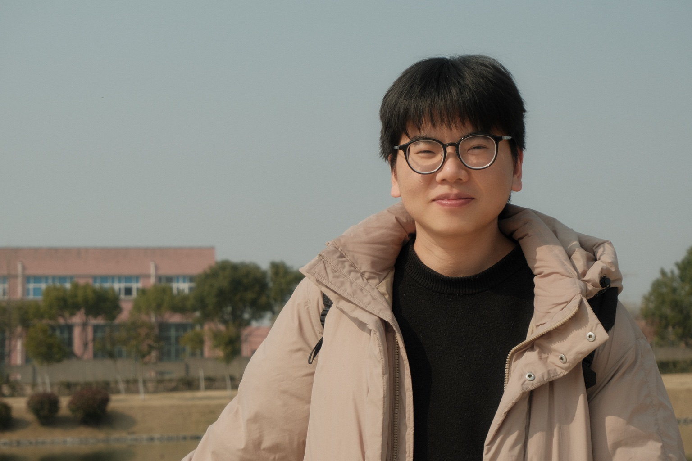

{: .profile-photo }

## About Me

I am currently a Postdoctoral Fellow in Applied Mathematics and Computational Science (AMCS) and the Center for Mathematical Biology (CMB) at the University of Pennsylvania, where I work with Professor [Yoichiro Mori](https://www.sas.upenn.edu/~y1mori/). I completed my Ph.D. in Mathematics at Shanghai Jiao Tong University from 2020 to 2024 under the supervision of Professor [Wenjun Ying](https://math.sjtu.edu.cn/faculty/wying/), after receiving my undergraduate training in Mathematics and Applied Mathematics there from 2016 to 2020.

My research focuses on partial differential equations arising in physical and biological systems, with particular emphasis on fluid–structure interactions involving deformable thin objects, such as membranes and filaments, in viscous fluids. I study these systems through a combination of mathematical analysis and numerical simulation, with particular interest in the well-posedness of the governing PDEs and in the stability, bifurcation, and long-time behavior of the resulting dynamics. I also develop and analyze accurate and efficient immersed-type methods (e.g., IBM, IIM, KFBIM) for PDEs on irregular and moving domains, with strong connections to potential theory and boundary integral equations. More recently, I have become interested in how geometric irregularities, such as open edges, corners, and triple junctions, influence both the mathematical structure of the governing equations and their numerical approximation.

[Read my research statement]({{ '/research/' | relative_url }})

**Email:** [hzhou24@sas.upenn.edu](mailto:hzhou24@sas.upenn.edu)  
**Office:** DRL 3N8B, David Rittenhouse Laboratory, Philadelphia, PA, USA

## Publications and Preprints

† Authors listed in alphabetical order. &#42; Corresponding author.

### Preprints

1. H. Zhou, Y.-W. Chang, Y. Mori&#42;,
   *Free-edge mechanics and hydrodynamic coupling shape membrane remodeling after pore opening*,
   2026. [bioRxiv](https://doi.org/10.64898/2026.11.20.768126)

2. H. Zhou,
   *High-Order Regularization for Singular and Nearly Singular Laplace and Stokes Layer Potentials in Two Dimensions*,
   arXiv:2611.21991. [arXiv](https://arxiv.org/abs/2611.21991)

3. H. Zhou,
   *Open Inextensible Filaments in Planar Stokes Flow: Well-Posedness, Endpoint Asymptotics, and Straightening*,
   arXiv:2609.10480. [arXiv](https://arxiv.org/abs/2609.10480)

4. H. Zhou, Y. Mori, L. Yao,
   *A Cartesian grid method for advection-diffusion equations with Robin boundary conditions on moving domains*,
   arXiv:2607.26341. [arXiv](https://doi.org/10.48550/arXiv.2607.26341)

5. E. García-Juárez, S. V. Haziot, P.-C. Kuo, Y. Mori, H. Zhou†,
   *On the global asymptotic stability for the 3D Peskin Problem at critical regularity*,
   arXiv:2607.11731. [arXiv](https://doi.org/10.48550/arXiv.2607.11731)

6. S. Kawakami, H. Zhou, P.-C. Kuo, Y. Mori, Y.-N. Young,
   *Stability and equilibria of a compressible elastic membrane in Stokes flow*,
   arXiv:2607.03357. [arXiv](https://doi.org/10.48550/arXiv.2607.03357)

7. S. Ling, W. Ying, H. Zhou&#42;,
   *Principal-part decomposition for neural operator learning of Dirichlet-to-Neumann maps*,
   arXiv:2606.25952. [arXiv](https://doi.org/10.48550/arXiv.2606.25952)

8. H. Zhou, S. Li, W. Ying,
   *A Cartesian grid-based boundary integral method for moving interface problems*,
   arXiv:2309.01068. [arXiv](https://doi.org/10.48550/arXiv.2309.01068)

9. H. Zhou, M. Huang, W. Ying,
   *ADI schemes for the heat equation on arbitrary 3D domains and their applications*,
   arXiv:2309.00979. [arXiv](https://doi.org/10.48550/arXiv.2309.00979)

### Published and accepted papers

1. H. Zhou, L. Yao, Y. Mori, Y. Li,
   *A conservative moving-boundary multiphysics framework reveals nonlinear coupling between osmotic flow and actin-driven cell migration*,
   *Frontiers in Systems Biology*, 6 (2026), in press.
   [DOI](https://www.frontiersin.org/journals/systems-biology/articles/10.3389/fsysb.2026.2022529/abstract) [bioRxiv](https://doi.org/10.64898/2026.10.09.757961)

2. H. Zhou, W. Ying,
   *A correction function-based KFBI method for Brinkman interface problems*,
   *Journal of Computational Physics*, 568:115404, 2027.
   [DOI](https://doi.org/10.1016/j.jcp.2026.115404) [arXiv](https://doi.org/10.48550/arXiv.2604.15509)

3. C. L. Epstein, Y. Mori, H. Zhou&#42;†,
   *Bulk-surface coupled PDE with an open boundary*,
   *Studies in Applied Mathematics*, 157(2):e70286, 2026.
   [DOI](https://doi.org/10.1111/sapm.70286) [arXiv](https://doi.org/10.48550/arXiv.2604.20798)

4. H. Zhou, Y.-N. Young, Y. Mori,
   *Modeling and simulation of open membranes in Stokes flow with mixed-dimensional coupling*,
   *Multiscale Modeling & Simulation*, 24(2):474–500, 2026.
   [DOI](https://doi.org/10.1137/25M1762476) [arXiv](https://doi.org/10.48550/arXiv.2504.16823)

5. P. Yin, W. Ying, Y. Zhang, H. Zhou&#42;†,
   *A kernel-free boundary integral method for elliptic interface problems on surfaces*,
   *Journal of Computational Physics*, 562:115004, 2026.
   [DOI](https://doi.org/10.1016/j.jcp.2026.115004)

6. H. Zhou, S. Li, W. Ying,
   *An alternating direction implicit method for mean curvature flows*,
   *Journal of Scientific Computing*, 101:65, 2024.
   [DOI](https://doi.org/10.1007/s10915-024-02701-3)

7. H. Zhou, W. Ying,
   *A correction function-based kernel-free boundary integral method for elliptic PDEs with implicitly defined interfaces*,
   *Journal of Computational Physics*, 496:112545, 2024.
   [DOI](https://doi.org/10.1016/j.jcp.2023.112545)

8. H. Zhou, J. Yang, W. Ying,
   *A kernel-free boundary integral method for the nonlinear Poisson-Boltzmann equation*,
   *Journal of Computational Physics*, 493:112423, 2023.
   [DOI](https://doi.org/10.1016/j.jcp.2023.112423)

9. H. Zhou, W. Ying,
   *A dimension splitting method for time dependent PDEs on irregular domains*,
   *Journal of Scientific Computing*, 94(1):20, 2023.
   [DOI](https://doi.org/10.1007/s10915-022-02066-5)

10. J. Xu, D. Hu, H. Zhou,
    *A phase-field method for elastic mechanics with large deformation*,
    *Journal of Computational Physics*, 471:111630, 2022.
    [DOI](https://doi.org/10.1016/j.jcp.2022.111630)

## Talks

- *2026 SIAM NNP Section Annual Meeting*, Rutgers University, Piscataway, NJ, October 2026
- *2026 SIAM Annual Meeting*, Cleveland, July 6-10, 2026
- *2026 CAIMS/SCMAI Annual Meeting*, Regina, June 15-19, 2026
- *2026 NCTS Workshop on Mathematics of Living Systems*, Hsinchu, May 20-22, 2026
- *Kanazawa University - Penn Soft Matter / Applied Math Workshop*, Philadelphia, March 23-25, 2026
- *2025 SIAM Great Lakes Section Annual Meeting*, Illinois Institute of Technology, Chicago, September 2025
- *Mathematical Modeling, Computational Methods, and Biological Fluid Dynamics: Research and Training*, Chicago, August 2025
- *Numerical Analysis and PDE Seminar*, Newark, May 2025
- *Fluid Mechanics and Waves Seminar*, Newark, November 2024
- *NCTS Seminar on PDE and Machine Learning*, Online, October 2024
- *The 10th International Congress on Industrial and Applied Mathematics*, Tokyo, August 2023
- *SICIAM Workshop on Recent Advances in Fast Algorithms*, Shenzhen, August 2023
- *Chinese Mathematical Society in Computational Mathematics*, Nanjing, July 2023
- *CSIAM Student Forum*, Online, November 2022
- *Shanghai Symposium on Scientific and Engineering Computing Methods*, Shanghai, November 2021

## Teaching

### University of Pennsylvania

- Instructor, AMCS 6035, *Numerical and Applied Analysis II*, Spring 2026
- Instructor, AMCS 6025, *Numerical and Applied Analysis I*, Fall 2025
- Instructor, AMCS 6035, *Numerical and Applied Analysis II*, Spring 2025
- Instructor, AMCS 6025, *Numerical and Applied Analysis I*, Fall 2024

### Shanghai Jiao Tong University

- Teaching Assistant, *Differential Geometry* (Fall 2023)
- Teaching Assistant, *Convex Optimization* (Spring 2022, Fall 2022)
- Teaching Assistant, *Scientific Computing* (Spring 2021, Fall 2021)
- Teaching Assistant, *Calculus* (Fall 2020)

### Graduate Project Supervision at the University of Pennsylvania

- Xiaoyi Jiang, AMCS graduate student, 2026
- Rui Xu, AMCS graduate student, 2025
- JiYao Zhang, AMCS graduate student, 2025

## CV

<a class="button-link" href="/assets/files/Han_CV.pdf">Download CV (PDF)</a>
